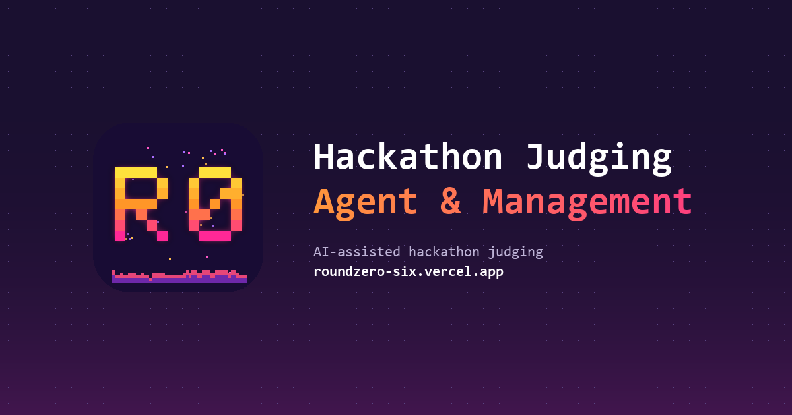

<p align="center">
  
</p>

<h1 align="center">RoundZero</h1>

<p align="center"><b>Round Zero happens before the judges arrive.</b><br>
The agent checks the code. The judges judge the idea.</p>

<p align="center">
  <a href="https://roundzero-six.vercel.app">Live app</a> ·
  <a href="https://roundzero-six.vercel.app/login?demo">Try the demo</a> ·
  <a href="#how-it-works">How it works</a> ·
  <a href="#run-it-locally">Run it locally</a>
</p>

---

## The problem

- Hackathons now get hundreds of projects for a small panel of judges.
- With AI coding tools, almost every project runs and ticks the required boxes, so the rules stop telling projects apart.
- Judges spend their time on checklist work: finding the repo, checking it builds, opening the demo, timing the video.
- By the hundredth project, judges are tired and good ideas get missed.

## What RoundZero does

RoundZero is an AI judging assistant for hackathons. Before any judge looks at a project, an AI agent checks it: it builds and tests the code in a cloud sandbox, reads the code, opens the live demo and checks the video. It then scores each criterion on the organizer's rubric, with the evidence behind every score.

Judges score what only people can judge: the idea, its impact and its design. They score blind and see the agent's verdict only after submitting their own. Submissions, judging rounds, rankings, awards and the winners page all run in one app.

## Features

| | Feature | What it does |
| --- | --- | --- |
| **AI review** | Review agent | Scores every criterion with reasoning, evidence, a confidence and feedback for the team |
| | Code sandbox | Clones, installs, builds and tests each repo in an isolated [Daytona](https://www.daytona.io) sandbox |
| | Code, web and video checks | Searches the repo, reads the live demo (via [Tavily](https://tavily.com)) and checks the video's length and transcript |
| | Double check | A larger model re-checks low-confidence verdicts and failed gates |
| | Gates and inbox | Must-pass rules; failing projects wait for an organizer to confirm or overturn |
| **Human judging** | Blind scoring | Judges score through private links, then see the agent's verdict and may change their score once |
| | Rounds | Multi-phase judging; the top projects advance each round |
| | Results | Rankings, awards and a public winners page |
| **Organizers** | Judging chat | Ask questions across all projects; answers cite the submissions and the web |
| | Intake | Add projects by hand, through a public submission form, or in bulk through the Projects API |
| | Audit trail | Every score, override and decision is logged |
| | Branding | Each hackathon gets its own logo, colour, submission form and judge portal |
| | Demo mode | Three sample hackathons behind a read-only demo login |

## How it works

1. **Set up.** The organizer writes the rubric. Each criterion is a 1–10 score or pass/fail, with a weight, and is checked by the agent, by judges, or both.
2. **Collect.** Teams submit through a public form, or projects are imported through the API.
3. **Agent review.** For each criterion the agent gathers evidence (sandbox, code, web, video), investigates with a few tool calls, and returns a schema-checked verdict.
4. **Triage.** Projects that fail a must-pass gate go to an inbox for a person to decide.
5. **Human judging.** Judges score their batch through private links.
6. **Results.** Closing a round ranks the projects and advances the top ones; the last round publishes the winners page.

Submission text is treated as data, never as instructions: a README that tries to steer the score gets a prompt-injection flag.

### The AI behind it

| Part | How it works | Models |
| --- | --- | --- |
| Review agent | Evidence first: reads the real repo, demo and video, then scores as strict JSON | NVIDIA Nemotron 3.5 Lightning (Quick), Nemotron 3 Ultra (Balanced, In-depth) |
| Judging chat | Agentic RAG: the model chooses tools, including vector search over the projects, scores, reviews and web search | Same Nemotron models |
| Search index | Each project and up to 3 linked pages are chunked, embedded and stored in Postgres with pgvector | Nemotron Embed 8B (1,024 dimensions) |

The models run on NVIDIA's API catalog ([build.nvidia.com](https://build.nvidia.com)). Nebius Token Factory is also supported as an alternative host.

## Tech stack

| Layer | Technology |
| --- | --- |
| App | Next.js 16, React 19, HeroUI, Tailwind CSS, hosted on Vercel |
| Database and auth | Supabase (Postgres, pgvector, Auth, Storage) |
| AI | NVIDIA Nemotron via the AI SDK |
| Sandboxes | Daytona |
| Web reading and search | Tavily |
| Email (optional) | Resend, React Email, Workflow DevKit |

Every service has a free tier, and the app runs end to end on free tiers.

## Run it locally

You need Node.js 20 or later and accounts for Supabase and NVIDIA. Daytona, Tavily and Resend are optional.

**1. Install**

```bash
pnpm install
```

**2. Create the database.** Create a Supabase project, then push the migrations:

```bash
pnpm supabase login
pnpm supabase link --project-ref your-project-ref
pnpm supabase db push
```

**3. Create an organizer.** In Supabase, open **Authentication → Users → Add user**, and keep **Auto Confirm User** on. Then turn off **Allow new users to sign up** under **Sign In / Providers**.

**4. Add environment variables** in `.env.local`:

```dotenv
# Required
NEXT_PUBLIC_SUPABASE_URL=https://your-project-ref.supabase.co
NEXT_PUBLIC_SUPABASE_PUBLISHABLE_KEY=sb_publishable_...
SUPABASE_SECRET_KEY=sb_secret_...
NVIDIA_API_KEY=nvapi-...

# Optional
DAYTONA_API_KEY=        # run submitted code in sandboxes
TAVILY=                 # read demo sites and search the web
RESEND=                 # send emails
FROM_EMAIL=             # sender on a domain verified in Resend
APP_URL=http://localhost:3000
DEMO_MODE=true          # show "Try the demo"
```

| Variable | Without it |
| --- | --- |
| Supabase keys | The app can't run |
| `NVIDIA_API_KEY` | No agent reviews or chat (or set `NEBIUS` instead) |
| `DAYTONA_API_KEY` | The agent skips running the code, but still reads it |
| `TAVILY` | The agent can't read demo sites or search the web |
| `RESEND`, `FROM_EMAIL` | No emails are sent |

The full list is in [configuration.mdx](src/content/docs/reference/configuration.mdx).

**5. Run**

```bash
pnpm dev
```

Open [http://localhost:3000](http://localhost:3000) and sign in. To try it fast, create a hackathon, click **Add sample data** under **Judging › Progress**, then **Start judging**.

**Optional: demo hackathons.** `pnpm demo:seed` creates three sample hackathons and the read-only demo login, with no AI calls.

## Deploy

1. Import the repository into [Vercel](https://vercel.com).
2. Add the same environment variables, with `APP_URL` and `SITE_HOSTS` set to your domain.
3. Deploy. A daily cron job (`vercel.json`) keeps the free Supabase project awake.

On the Vercel Hobby plan, pages that run agent reviews are limited to 300 seconds; set `AGENT_WORKER_BUDGET_MS=240000`, and unfinished reviews resume on the next run.

## Project structure

```text
src/
  app/
    h/[slug]/       Organizer app: setup, judging, results
    j/[token]/      Judge portal
    f/[token]/      Public submission form
    w/[slug]/       Public winners page
    api/intake/     Projects API
    landing/        Landing page
  lib/
    ai.ts           Models, embeddings and the Tavily client
    agent/          Review agent: evidence, tools, sandboxes, verdicts
  content/docs/     In-app documentation
supabase/migrations/  Database schema, security rules and judging functions
scripts/seed-demo.mjs Demo hackathons
```

## Credits

RoundZero is built on the open-source [RoundOne](https://github.com/impactvelocity/roundone-dev) project, released under the [MIT License](LICENSE).
